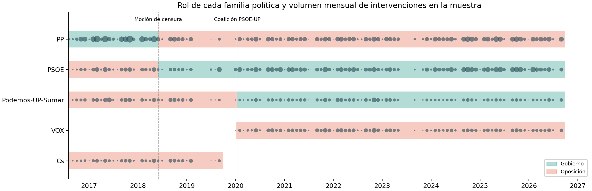
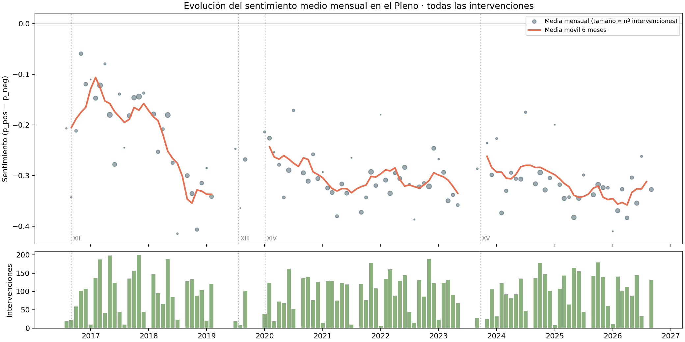
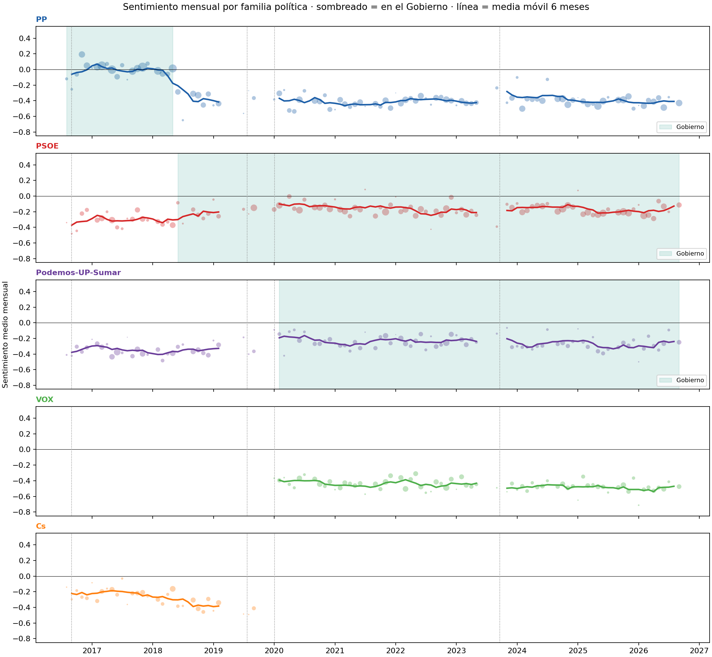
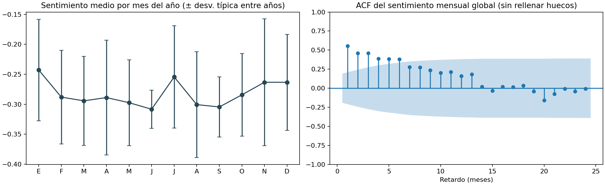
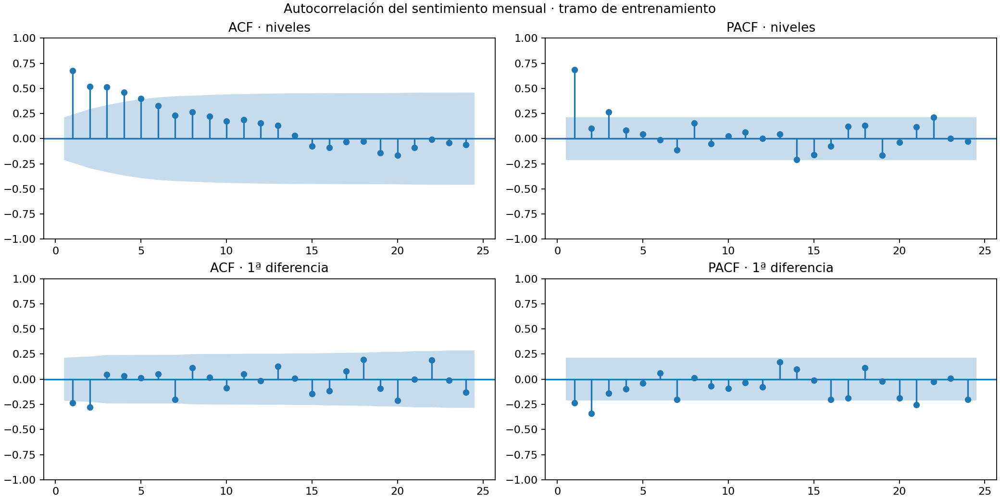
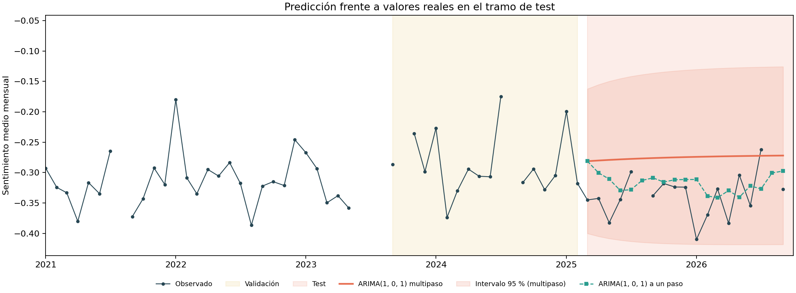
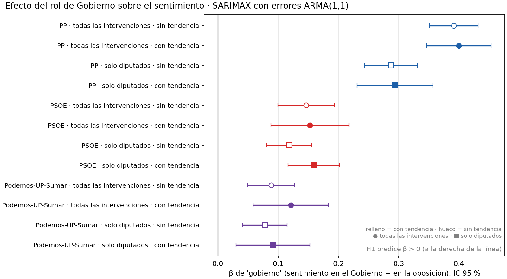
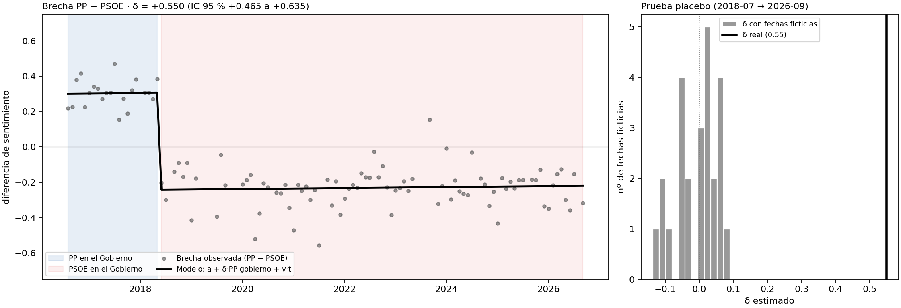

# Análisis temporal del sentimiento en las intervenciones parlamentarias (2016–2026)

## 1. Objetivo e hipótesis

En la Entrega 2 se generó un indicador de sentimiento para cada intervención parlamentaria. En esta tercera entrega se estudia su evolución temporal y se contrasta la hipótesis planteada entonces:

> **H1:** Las intervenciones de las familias políticas presentan, en promedio, puntuaciones de sentimiento más negativas durante los periodos en los que ejercen la oposición que durante aquellos en los que forman parte del Gobierno (2016–2026).

La hipótesis nula, **H0**, establece que no existe una diferencia sistemática de sentimiento entre ambos roles.

El análisis se organiza en cuatro pasos. Primero se construye una variable que identifica si cada familia política está en el Gobierno o en la oposición. Después se explora la evolución temporal del sentimiento. En tercer lugar se ajusta un modelo ARIMA para estudiar qué parte de la dinámica mensual puede predecirse a partir de su propio pasado. Por último, se incorpora el rol institucional como variable explicativa mediante modelos con errores ARMA y otros contrastes complementarios.

La variable analizada es `sentiment`, definida en la Entrega 2 como la diferencia entre la probabilidad de sentimiento positivo y la probabilidad de sentimiento negativo. Su rango es [-1, 1]: los valores más altos indican un tono más positivo y los más bajos, uno más negativo. Por tanto, H1 predice que la diferencia **Gobierno − oposición** sea positiva.

## 2. Construcción de la variable Gobierno/oposición

### 2.1. Criterio de clasificación

Para contrastar H1 es necesario conocer el rol institucional de cada partido en la fecha de cada intervención. Esta información no estaba incluida en el conjunto de datos original, por lo que se construyó una tabla de periodos de Gobierno a partir de las fechas de toma de posesión de los ejecutivos.

Se considera que una familia política está en el Gobierno cuando cuenta con ministros. Los Gobiernos en funciones también se clasifican como Gobierno. El cambio de rol se fecha en la toma de posesión: el PSOE pasa al Gobierno el 2 de junio de 2018, tras la moción de censura, y Unidas Podemos entra en el Gobierno de coalición el 13 de enero de 2020. De esta forma, las intervenciones de los debates previos a esas tomas de posesión conservan el rol anterior.

El apoyo parlamentario sin presencia de ministros no se considera formar parte del Gobierno. Por este motivo, Ciudadanos durante el Gobierno de Rajoy y Unidas Podemos durante el primer Gobierno de Pedro Sánchez se clasifican como oposición. Esta decisión es discutible, pero mantiene un criterio homogéneo basado en la pertenencia efectiva al Consejo de Ministros.

En el periodo estudiado, tres familias cambian de rol: PP, PSOE y Podemos-UP-Sumar. VOX y Ciudadanos permanecen en la oposición durante todo el intervalo y, por tanto, no permiten estimar un cambio propio de rol. Desde diciembre de 2023, la familia agregada Podemos-UP-Sumar contiene en la muestra intervenciones del grupo parlamentario de Sumar.

*Figura 1. Periodos clasificados como Gobierno y oposición. Los puntos representan el volumen mensual de intervenciones de la muestra.*

### 2.2. Intervenciones de ministros y panel mensual

Además del rol del partido, se identificaron las intervenciones realizadas por miembros del Gobierno (ministros o presidente). Esta distinción permite comprobar si las diferencias observadas se deben únicamente a que, cuando un partido gobierna, también intervienen sus ministros.

La clasificación se comprobó de varias maneras: no aparecen miembros del Gobierno adscritos a partidos clasificados como oposición; se verificó la composición de las intervenciones de la familia Podemos-UP-Sumar desde diciembre de 2023; y el sentimiento mensual recalculado coincide con el de `monthly_party.csv` de la Entrega 2.

Con esta información se construyó un panel mensual partido × mes con el número de intervenciones, el sentimiento medio de todas las intervenciones, el sentimiento medio excluyendo a los miembros del Gobierno, el número de intervenciones de estos últimos y la variable binaria `gobierno`.

Para asignar el rol mensual se utiliza el rol mayoritario entre las intervenciones del mes cuando existen intervenciones de ambos roles; en los meses sin intervenciones se utiliza el rol vigente el día 15. Los indicadores de sentimiento de los meses sin intervenciones se mantienen como valores ausentes, no como ceros. Este criterio permite disponer de una variable exógena de Gobierno en todos los meses sin inventar observaciones de sentimiento.

La comparación descriptiva inicial ya apunta en la dirección de H1. Para todas las intervenciones, la diferencia Gobierno − oposición es de +0,416 en el PP, +0,123 en el PSOE y +0,104 en Podemos-UP-Sumar. Al excluir a ministros, las diferencias siguen siendo positivas: +0,292, +0,101 y +0,091, respectivamente. Estas cifras son únicamente descriptivas: no controlan la evolución temporal ni la autocorrelación y, por sí solas, no permiten concluir que exista un efecto del rol.

## 3. Exploración temporal

### 3.1. Cobertura y meses sin observaciones

La serie global abarca 122 meses de calendario, desde agosto de 2016 hasta septiembre de 2026. Hay datos en 104 meses y 18 meses sin intervenciones en la muestra. Los huecos se conservan como valores ausentes: no representan un sentimiento igual a cero.

Los meses de agosto concentran buena parte de los huecos, ya que habitualmente no se celebran sesiones plenarias. También aparecen ausencias relacionadas con la disolución de las Cortes y la constitución de nuevas legislaturas, especialmente alrededor de las elecciones de 2019 y 2023. Por tanto, no se trata necesariamente de errores de registro y no resulta apropiado rellenarlos de forma automática.

El sentimiento individual presenta una desviación típica aproximada de 0,29. En las series por partido, la mediana mensual se sitúa entre unas 15 y 35 intervenciones, lo que se traduce en errores estándar aproximados de 0,04–0,06 para las medias mensuales. En consecuencia, parte de las oscilaciones de un mes a otro puede deberse al tamaño y composición de la muestra. Por este motivo, la interpretación se centra también en tendencias suavizadas y modelos temporales, y no únicamente en puntos mensuales aislados.

### 3.2. Evolución global y por partido

La serie global muestra una tendencia descriptiva negativa. Una recta ajustada sobre el tiempo estima una pendiente de −0,0142 unidades de sentimiento por año, equivalente a una caída aproximada de 0,143 unidades en los 10,1 años estudiados. El sentimiento medio por legislatura también desciende: −0,208 en la XII, −0,271 en la XIII, −0,308 en la XIV y −0,326 en la XV.

Esta tendencia global debe interpretarse con cautela. La media de cada mes depende de qué partidos intervienen y en qué proporción. Por ejemplo, VOX aparece en la muestra a partir de 2020 y presenta un sentimiento medio especialmente negativo. Por tanto, la caída agregada no implica necesariamente que todos los partidos hayan ido adoptando un tono progresivamente más negativo. Para estudiar H1 es más informativo analizar cada familia política por separado.

*Figura 2. Sentimiento medio mensual de todas las intervenciones, media móvil de seis meses y volumen mensual de la muestra. Las líneas verticales señalan cambios de legislatura.*

La evolución por partido muestra una relación visual entre el rol institucional y el sentimiento: en los periodos de Gobierno, el sentimiento tiende a situarse en niveles más altos que en los periodos de oposición. El contraste más visible se produce en junio de 2018, cuando PP y PSOE intercambian sus roles. En enero de 2020, Podemos-UP-Sumar pasa a formar parte del Gobierno de coalición.

*Figura 3. Evolución del sentimiento medio por partido*

Las medias móviles utilizadas en esta visualización están centradas y, por tanto, incorporan observaciones anteriores y posteriores al mes representado. Su función es suavizar el ruido, no fechar con precisión los cambios. Para localizar los cambios de rol deben consultarse los puntos mensuales y las fechas de toma de posesión.

### 3.3. Comparación descriptiva alrededor de los cambios de Gobierno

Como comprobación adicional, se comparó el sentimiento de los doce meses anteriores y posteriores a cada cambio de Gobierno. En junio de 2018, el sentimiento del PP desciende de −0,005 a −0,366 (cambio de −0,361), mientras que el del PSOE aumenta de −0,314 a −0,217 (cambio de +0,098). Podemos-UP-Sumar y Ciudadanos, que permanecen en la oposición, sirven como referencia: sus cambios son +0,040 y −0,136, respectivamente.

En enero de 2020, Podemos-UP-Sumar pasa de −0,290 a −0,212 (cambio de +0,078). El PSOE, que continúa en el Gobierno, cambia +0,043, y el PP, que continúa en la oposición, cambia +0,010. Esta comparación también apunta en la dirección prevista por H1, aunque las ventanas no contienen el mismo número de intervenciones y la comparación es descriptiva. No controla la autocorrelación ni los cambios en los temas debatidos.

### 3.4. Estacionalidad, anomalías y estacionariedad

Se examinó si el sentimiento presenta un patrón anual. El perfil por mes del año muestra variaciones entre meses, pero también una variabilidad considerable entre años; agosto, además, solo dispone de observaciones en cuatro años. La ACF mensual no ofrece una señal anual suficientemente clara y estable en los retardos 12 y 24 como para justificar, con estos datos, la incorporación de una componente estacional. Por ello, el modelo predictivo posterior se centra en una estructura ARIMA no estacional.

También se identificaron meses cuyo sentimiento se aparta de su entorno. Para ello se comparó cada mes con una media móvil centrada de trece meses que excluye el propio mes, considerando únicamente meses con al menos treinta intervenciones. Se marcaron como candidatos a anomalía aquellos con una desviación estandarizada absoluta superior a dos. Entre los candidatos aparecen noviembre de 2016, junio de 2017, noviembre de 2018, julio de 2020, febrero de 2024 y julio de 2024. Este umbral es heurístico: señala meses que merecen revisión, pero no demuestra que sean errores ni identifica la causa de la desviación.

La estacionariedad se estudió mediante la prueba ADF, cuya hipótesis nula es la presencia de una raíz unitaria. En la serie global en niveles, el resultado depende del tratamiento de los meses ausentes: al eliminar los huecos se obtiene p = 0,0851, mientras que al interpolarlos para este diagnóstico se obtiene p = 0,0420. La conclusión, por tanto, es sensible al tratamiento de los huecos. En primera diferencia, los p-valores son inferiores a 0,05 en ambos tratamientos. En las series del PP y PSOE tampoco se rechaza la raíz unitaria en niveles, mientras que Podemos-UP-Sumar presenta evidencia de estacionariedad en niveles.

La interpolación se utiliza únicamente para poder aplicar pruebas que no admiten huecos; no se emplea para construir la serie que se modela. En el siguiente notebook, el diagnóstico ADF se repite sobre el tramo de entrenamiento para evitar utilizar información del periodo de evaluación.

*Figura 4. Sentimiento medio por mes del año y ACF global hasta 24 retardos. Las barras de error muestran la desviación típica entre años.*

## 4. Modelado predictivo de la serie global: ARIMA

### 4.1. División temporal y diagnóstico

El objetivo de este paso no es contrastar directamente H1, sino estudiar hasta qué punto el sentimiento mensual global puede predecirse a partir de su propio pasado. Para ello se dividió la serie cronológicamente, sin barajar observaciones: entrenamiento desde agosto de 2016 hasta agosto de 2023 (85 meses de calendario, 71 con dato), validación desde septiembre de 2023 hasta febrero de 2025 (18 meses, 16 con dato) y test desde marzo de 2025 hasta septiembre de 2026 (19 meses, 17 con dato).

La separación cronológica evita que el modelo utilice información futura para predecir el pasado. Además, validación y test pertenecen a la legislatura XV, por lo que evalúan la predicción en un tramo sin cambios de rol del Gobierno central.

En el entrenamiento, la prueba ADF en niveles no ofrece una conclusión robusta: al eliminar los huecos se obtiene p = 0,3451, mientras que con interpolación se obtiene p = 0,0022. En primera diferencia, ambos tratamientos conducen a rechazar la hipótesis de raíz unitaria. La ACF en niveles decae lentamente, compatible con persistencia o con un cambio de nivel; en primera diferencia destaca el retardo 1. Estos resultados justifican probar especificaciones con y sin diferenciación, en lugar de imponer una única opción desde el principio.

*Figura 5. Funciones de autocorrelación y autocorrelación parcial calculadas sobre el tramo de entrenamiento. La interpolación se utiliza solo para los diagnósticos que no admiten huecos; el ajuste posterior conserva los valores ausentes.*

### 4.2. Selección del modelo

Se evaluó una rejilla de modelos ARIMA con p y q entre 0 y 2, y d igual a 0 o 1. Para d = 0 se probaron especificaciones con constante y, cuando correspondía, tendencia; para d = 1 se probaron especificaciones sin término determinista o con deriva. De los 36 candidatos, 34 convergieron y dos se descartaron por falta de convergencia.

La selección se realizó por RMSE multipaso en validación. Cuando los candidatos presentaban errores muy próximos (diferencias inferiores a 0,002), se priorizó el menor BIC como criterio de parsimonia. El modelo elegido fue **ARIMA(1,0,1) con constante**. Su RMSE multipaso en validación fue 0,0517, muy próximo al mejor candidato, y presentó el menor BIC entre los modelos considerados.

La comparación con métodos de referencia es importante para valorar si el modelo aporta capacidad predictiva real. En validación, el RMSE del ingenuo multipaso fue 0,0870, mientras que el de la media del entrenamiento fue 0,0542 y el de la media de los últimos doce meses fue 0,0564. El ARIMA seleccionado mejora esos valores en el horizonte multipaso, aunque la ventaja frente a las referencias basadas en medias es reducida.

### 4.3. Evaluación en test

Tras seleccionar el modelo, se reajustó con entrenamiento y validación y se evaluó una sola vez sobre el test. Los resultados dependen del horizonte de predicción:

| Método | MAE | RMSE | Observaciones |
|---|---:|---:|---:|
| ARIMA(1,0,1), multipaso | 0,0643 | 0,0716 | 17 |
| ARIMA(1,0,1), un paso | 0,0376 | 0,0451 | 17 |
| Ingenuo, multipaso | 0,0311 | 0,0401 | 17 |
| Ingenuo, un paso | 0,0430 | 0,0506 | 17 |
| Media de los últimos 12 meses | 0,0532 | 0,0607 | 17 |
| Media del entrenamiento | 0,0687 | 0,0759 | 17 |

A un paso, actualizando la predicción cada mes con el último dato real, el ARIMA obtiene un RMSE de 0,0451, inferior al 0,0506 del método ingenuo. En cambio, en la predicción multipaso el ARIMA obtiene un RMSE de 0,0716, peor que el 0,0401 del ingenuo.

La diferencia se explica por el cambio de nivel del periodo final. El modelo ARIMA estacionario tiende a regresar a su media estimada, aproximadamente −0,27, influida por los primeros años de la serie, que fueron más positivos. Sin embargo, el test (2025–2026) presenta una media cercana a −0,34. Al no incorporar variables externas, el modelo no anticipa ese nivel más negativo. El método ingenuo funciona mejor en multipaso porque el último dato de validación ya se encontraba cerca del nivel observado posteriormente.

*Figura 6. Predicciones a un paso y multipaso frente a los valores observados en el tramo de test.*

En consecuencia, la serie contiene una dinámica de corto plazo que puede modelarse, pero su nivel también cambia por factores que no están recogidos en su propio pasado. Este resultado motiva la incorporación de una variable exógena en el siguiente paso.

### 4.4. Diagnóstico de residuos

Los residuos del modelo presentan una media de −0,024 y una desviación típica de 0,923 en la escala estandarizada mostrada por el ajuste. La prueba de Ljung-Box no detecta autocorrelación conjunta significativa en los retardos 6 y 12 (p = 0,6778 y p = 0,8280, respectivamente). Esto indica que el modelo recoge buena parte de la dependencia temporal que se observa en la serie.

No obstante, los diagnósticos también señalan desviaciones respecto a los supuestos habituales: el contraste de heterocedasticidad da p = 0,03. Los residuos presentan, por tanto, indicios de varianza no constante. Esto no invalida automáticamente las predicciones puntuales, pero aconseja interpretar con cautela los intervalos de confianza.

## 5. Contraste de H1 mediante modelos con el rol de Gobierno

### 5.1. Planteamiento del modelo

El notebook anterior muestra que el sentimiento mensual es persistente y que el modelo univariante no anticipa por sí solo los cambios de nivel. Para contrastar H1 se incorpora el rol institucional como variable exógena en una regresión con errores ARMA(1,1):

$
y_t = a + \beta\,\text{gobierno}_t + \gamma t + u_t,
\qquad u_t \sim \operatorname{ARMA}(1,1).
$

Aquí, $y_t$ es el sentimiento medio mensual del partido, `gobierno` vale 1 cuando el partido forma parte del Gobierno y 0 cuando está en la oposición, y $t$ representa una tendencia lineal en años. Los errores ARMA recogen la dependencia entre meses consecutivos. El parámetro de interés es $\beta$: mide la diferencia estimada entre el sentimiento en el Gobierno y en la oposición, manteniendo constantes la tendencia y la estructura temporal de los errores.

H1 recibe apoyo cuando $\beta > 0$ y su intervalo de confianza del 95 % no incluye el cero. Se estiman modelos para PP, PSOE y Podemos-UP-Sumar, los tres partidos que cambian de rol. VOX y Ciudadanos no permiten estimar ese efecto porque permanecen en la oposición durante todo el periodo.

Se comparan especificaciones con y sin tendencia, con todas las intervenciones y excluyendo a los miembros del Gobierno. También se ajusta un AR(1) como comprobación de robustez frente a la estructura ARMA(1,1) elegida en el notebook 03.

### 5.2. Resultados por partido

En los modelos principales con tendencia y errores ARMA(1,1), los tres coeficientes de Gobierno son positivos y sus intervalos de confianza del 95 % no incluyen el cero:

| Partido | Todas las intervenciones: β | IC 95 % | Solo diputados: β | IC 95 % |
|---|---:|---:|---:|---:|
| PP | 0,3996 | [0,3457; 0,4535] | 0,2938 | [0,2311; 0,3564] |
| PSOE | 0,1527 | [0,0881; 0,2172] | 0,1591 | [0,1165; 0,2017] |
| Podemos-UP-Sumar | 0,1211 | [0,0588; 0,1834] | 0,0912 | [0,0300; 0,1525] |

Los resultados indican que el sentimiento medio es más positivo cuando estos partidos forman parte del Gobierno que cuando están en la oposición, una vez controladas la tendencia y la autocorrelación. El tamaño estimado es heterogéneo: el efecto es grande para el PP, moderado para el PSOE y menor para Podemos-UP-Sumar.

Al excluir a ministros y presidente, el coeficiente del PP se reduce de aproximadamente 0,40 a 0,29, lo que indica que la composición de las intervenciones ministeriales explica parte de la diferencia. Sin embargo, el efecto continúa siendo positivo y su intervalo no incluye el cero. En PSOE y Podemos-UP-Sumar, las estimaciones también permanecen positivas. Por tanto, el resultado no parece deberse únicamente a la intervención de miembros del Gobierno.

Añadir una tendencia lineal apenas modifica los coeficientes principales. Esto sugiere que la diferencia entre Gobierno y oposición no se explica simplemente por la tendencia temporal global. Además, la estimación se mantiene al sustituir los errores ARMA(1,1) por AR(1), según las comprobaciones del notebook.

*Figura 7. Coeficientes de Gobierno estimados para cada partido y especificación. Los intervalos que no cruzan cero indican diferencias estadísticamente distintas de cero bajo el modelo ajustado.*

### 5.3. Brecha entre PP y PSOE

Como contraste adicional, se estudia la diferencia mensual entre el sentimiento del PP y el del PSOE:

$
\text{brecha}_t = \text{PP}_t - \text{PSOE}_t.
$

En junio de 2018 ambos partidos intercambian sus roles, por lo que esta diferencia permite observar el cambio relativo entre ellos. Los factores que afectan por igual a ambos partidos —por ejemplo, cambios generales del clima político o del conjunto de temas debatidos— pueden cancelarse parcialmente al restar las dos series.

El modelo con tendencia y errores ARMA(1,1) estima un coeficiente $\delta = 0,5498$, con intervalo de confianza del 95 % [0,4648; 0,6347]. La estimación es muy próxima a la suma de los efectos individuales estimados para PP y PSOE (aproximadamente 0,40 + 0,15). El resultado es coherente con la hipótesis de que el rol institucional está asociado a diferencias en el tono de ambos partidos.

### 5.4. Prueba placebo

Para comprobar si el modelo de la brecha tiende a encontrar saltos de nivel incluso cuando no existe un cambio real de Gobierno, se repitió el análisis utilizando fechas ficticias entre julio de 2019 y julio de 2025, separadas por tres meses y dejando al menos doce meses de observaciones a cada lado.

El efecto real estimado es $\delta = 0,550$. La media de los efectos placebo es −0,008 y el valor absoluto máximo es 0,137. Ninguno de los 25 efectos placebo alcanza la magnitud del efecto real. Esto refuerza la interpretación de que el salto observado alrededor del cambio de Gobierno de 2018 es excepcional respecto a los saltos que el mismo procedimiento encuentra en fechas sin cambio de rol.

Sin embargo, cuatro de los 25 placebos presentan un p-valor inferior a 0,05. Esto sugiere que los p-valores convencionales del modelo pueden ser algo optimistas ante fluctuaciones lentas del nivel de la serie. Por ello, la comparación del tamaño del efecto real con la distribución placebo es especialmente relevante; no conviene basar la conclusión únicamente en la significación estadística convencional.

*Figura 8. A la izquierda, evolución de la brecha observada y efecto estimado del cambio de rol. A la derecha, distribución de los coeficientes obtenidos con fechas ficticias frente al efecto real.*

### 5.5. Comprobación mediante panel con efectos fijos

Como contraste complementario, se estimó un modelo de panel con efectos fijos de partido y de mes. Los efectos fijos de partido controlan diferencias permanentes entre familias políticas, mientras que los efectos fijos mensuales absorben los factores comunes a todos los partidos en cada mes. VOX y Ciudadanos, que permanecen en la oposición, contribuyen a identificar esos cambios comunes.

El coeficiente estimado para la variable Gobierno es 0,2335 (IC 95 %: [0,2045; 0,2624]) con todas las intervenciones y 0,1806 (IC 95 %: [0,1537; 0,2075]) al considerar solo diputados. Ambos intervalos excluyen el cero y mantienen el signo esperado por H1.

Este panel no es un modelo de series temporales, sino una comprobación con una estructura y unos supuestos diferentes. Los errores estándar se agrupan por mes, lo que tiene en cuenta la correlación entre partidos dentro de un mismo mes, pero no corrige la autocorrelación temporal dentro de cada partido. Por ello, sus intervalos deben interpretarse con cautela.

## 6. Conclusiones: contraste de la hipótesis

Los resultados obtenidos **apoyan H1** en el periodo 2016–2026. En los tres partidos que cambian de rol, los coeficientes estimados de Gobierno son positivos y sus intervalos de confianza del 95 % no incluyen el cero. La diferencia también se mantiene al excluir las intervenciones de ministros, al controlar una tendencia temporal y al modificar la estructura de los errores ARMA.

Los contrastes complementarios apuntan en la misma dirección. La brecha PP − PSOE presenta un efecto estimado de aproximadamente 0,55, muy superior a los efectos obtenidos con fechas placebo. El panel con efectos fijos de partido y mes también estima una diferencia positiva entre Gobierno y oposición.

La magnitud del resultado no es igual para todas las familias: es especialmente elevada en el PP (β ≈ 0,40), moderada en el PSOE (β ≈ 0,15) y menor en Podemos-UP-Sumar (β ≈ 0,12). La exclusión de ministros reduce parte del efecto del PP, pero no lo elimina. Por tanto, los resultados son compatibles con que el rol institucional esté asociado a cambios en el tono de las intervenciones parlamentarias.

Esta conclusión debe entenderse como evidencia de **asociación**, no como una demostración causal. Solo se observan dos cambios de Gobierno relevantes y tres partidos que cambian de rol. Cualquier otro acontecimiento que coincida temporalmente con esos cambios podría estar confundido con el efecto estimado. Los análisis realizados reducen algunas explicaciones alternativas —tendencia general, factores comunes a la Cámara, intervención de ministros y saltos de nivel en fechas ficticias—, pero no eliminan todas las posibles variables omitidas.

## 7. Limitaciones y posibles mejoras

- **Pocas transiciones de rol.** La identificación del efecto se apoya principalmente en los cambios de 2018 y 2020. Sería necesario ampliar el periodo o incorporar más cambios de Gobierno para comprobar si el patrón se reproduce en otros contextos.
- **Definición de Gobierno.** Clasificar como oposición a partidos que apoyan parlamentariamente a un ejecutivo sin tener ministros es una decisión metodológica discutible. Una extensión podría distinguir entre Gobierno, apoyo externo y oposición.
- **Composición de las intervenciones.** La proporción de ministros y diputados varía según partido y periodo. Se ha comprobado el resultado excluyendo a los miembros del Gobierno, pero podrían estudiarse otras diferencias en el tipo de intervención o en el cargo del orador.
- **Medición del sentimiento.** RoBERTuito se entrenó con mensajes de redes sociales, no específicamente con intervenciones parlamentarias. La ironía, las citas, las fórmulas de cortesía y el lenguaje institucional pueden introducir errores de clasificación. Una validación manual de una muestra parlamentaria permitiría evaluar este sesgo.
- **Muestra y agregación mensual.** El corpus es una muestra de intervenciones y no necesariamente representa con idéntica cobertura todos los debates. Además, en los modelos mensuales cada mes con dato tiene el mismo peso, aunque el número de intervenciones sea distinto. Una mejora sería ponderar por volumen o modelar directamente la incertidumbre de cada media mensual.
- **Meses ausentes.** Los huecos se conservan para evitar inventar observaciones, pero algunas pruebas diagnósticas como ADF y PACF requieren series completas. La interpolación se utiliza únicamente en esos diagnósticos y puede afectar a sus resultados.
- **Predicción univariante limitada.** El ARIMA mejora la predicción a un paso, pero no la predicción multipaso en test. Incorporar variables exógenas, como el rol de Gobierno, el volumen de intervenciones o indicadores del contexto parlamentario, podría mejorar la explicación de los cambios de nivel.
- **Diagnóstico de residuos.** Aunque Ljung-Box no detecta autocorrelación residual significativa, aparecen indicios de heterocedasticidad y desviaciones de la normalidad. Se podrían explorar errores robustos, modelos de varianza condicional o intervalos de predicción más adecuados.
- **Interpretación de los efectos.** Los modelos controlan algunos factores temporales y comunes, pero no todas las circunstancias políticas que cambian simultáneamente con el rol. Por ello, los coeficientes no deben interpretarse como efectos causales definitivos.

## 8. Figuras incluidas

Las figuras seleccionadas cubren las partes principales del análisis sin reproducir todos los gráficos exploratorios:

1. Cronología del rol institucional y volumen de intervenciones (`01_cronologia_gobierno.png`).
2. Evolución global del sentimiento y volumen mensual (`02_sentimiento_global.png`).
3. Perfil estacional y autocorrelación global (`02_estacionalidad_acf.png`).
4. ACF y PACF del entrenamiento (`03_acf_pacf_train.png`).
5. Predicción frente a valores reales en test (`03_prediccion_test.png`).
6. Coeficientes del rol de Gobierno e intervalos de confianza (`04_coeficientes_gobierno.png`).
7. Brecha PP-PSOE y prueba placebo (`04_brecha_placebo.png`).

Para que las imágenes se visualicen al abrir este documento, deben encontrarse en la carpeta `results/` con esos nombres. Las figuras de sentimiento por partido, residuos y contrafactuales pueden conservarse en `results/` como material complementario, aunque no es imprescindible incluirlas todas en el documento principal.
